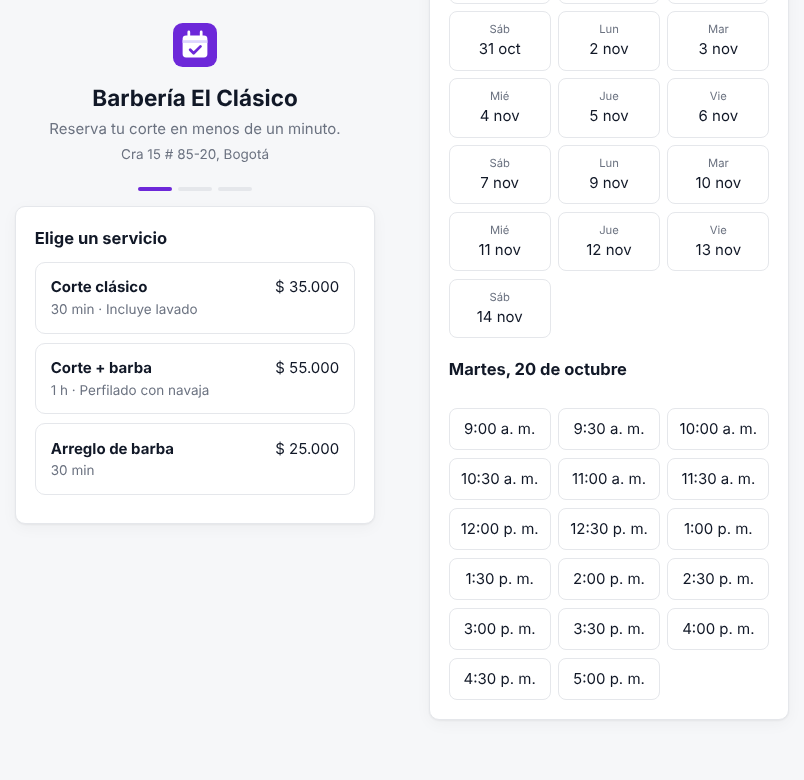
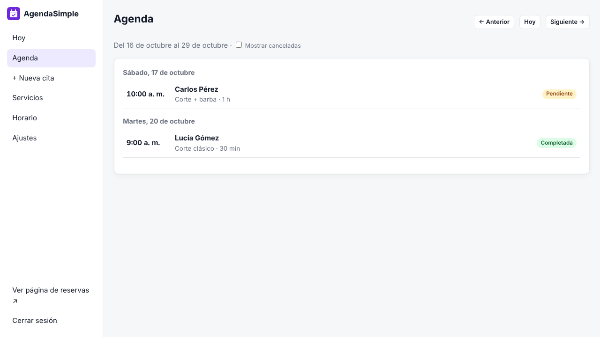

# AgendaSimple

Reservas en línea para barberías, peluquerías, consultorios, spas, talleres y cualquier negocio que trabaje con citas. En español, sin mensualidades y en tu propio servidor.

<!-- Cuando Hostinger abra su programa para desarrolladores, pega aquí el botón con tu código de referencia:
[](URL_DE_IMPLEMENTACIÓN_CON_TU_CÓDIGO)
-->



## Qué hace

**Para tus clientes**, en una página pensada para el celular:

- Eligen el servicio, el día y la hora. Solo ven los horarios que de verdad están libres.
- Reciben un enlace para ver o cancelar su reserva sin crear cuenta.
- Te avisan por WhatsApp con un botón que abre el chat con el mensaje ya escrito.

**Para ti**, en el panel (`/admin`):

- **Hoy:** las citas del día, las pendientes por confirmar y tu enlace de reservas para compartir.
- **Agenda** de dos semanas con estados: pendiente, confirmada, completada, no asistió y cancelada.
- **Mensajes de WhatsApp listos** para confirmar, recordar o avisar una cancelación: un clic y se abre el chat con el cliente.
- **Reprogramar** citas eligiendo entre los horarios libres.
- **Servicios** con duración y precio.
- **Horario** por día, con varios tramos para el cierre del mediodía y días bloqueados por festivos o vacaciones.
- **Reglas:** intervalo entre horarios, anticipación mínima, hasta cuántos días adelante se puede reservar y cuántas citas simultáneas atiendes.
- **Copia de seguridad** y restauración en un clic.
- **Sin dependencias:** solo necesita Node.js 18 o superior. No usa base de datos externa.



> **Sobre WhatsApp:** AgendaSimple no envía mensajes automáticos. Usa enlaces `wa.me`, que abren WhatsApp con el mensaje escrito para que tú o tu cliente lo envíen con un toque. Así no necesitas la API de WhatsApp Business ni pagar por mensajes.

## Instalación

### Opción 1: Docker (recomendada, ideal para un VPS)

```bash
git clone https://github.com/Gestiiona/agenda-simple.git
cd agenda-simple
cp .env.example .env      # edita ADMIN_PASSWORD
docker compose up -d
```

- Página de reservas: `http://IP-DE-TU-SERVIDOR:3000`
- Panel: `http://IP-DE-TU-SERVIDOR:3000/admin`

### Opción 2: Node.js

```bash
git clone https://github.com/Gestiiona/agenda-simple.git
cd agenda-simple
ADMIN_PASSWORD="tu-contraseña-segura" npm start
```

### Primeros pasos

1. Entra a `/admin` con tu contraseña.
2. En **Ajustes**, escribe el nombre del negocio y tu **WhatsApp con indicativo** (por ejemplo `+57 300 000 0000`).
3. En **Servicios**, crea lo que ofreces con su duración.
4. En **Horario**, ajusta tus días y horas de atención.
5. Comparte tu enlace en Instagram, en tu WhatsApp Business o en tu ficha de Google.

### Variables de entorno

| Variable | Para qué sirve | Por defecto |
|---|---|---|
| `ADMIN_PASSWORD` | Contraseña del panel (mínimo 8 caracteres). **Defínela siempre.** | — |
| `PORT` | Puerto del servidor | `3000` |
| `DATA_DIR` | Carpeta donde se guardan los datos | `./data` |
| `SETUP_CODE` | Código fijo para la configuración inicial, si no usas `ADMIN_PASSWORD` | aleatorio |

**Sin `ADMIN_PASSWORD`**, el panel pide un *código de configuración* que se imprime en los registros (logs) del servidor. Así nadie más puede adueñarse de tu instalación antes que tú.

## Tus datos

Todo se guarda en `data/db.json`.

- **Docker:** los datos viven en el volumen `agendasimple-data` y sobreviven a reinicios y actualizaciones.
- **Hosting administrado (por ejemplo, Web Apps de Node.js):** comprueba que la carpeta de datos se conserve al volver a desplegar. Si no estás seguro, apunta `DATA_DIR` a una carpeta persistente o usa un VPS con Docker.
- **Haz copias de seguridad** desde *Ajustes → Descargar copia*.

## Seguridad

- Contraseña guardada con `scrypt` y sesión en una cookie firmada `HttpOnly`.
- Límite de intentos de acceso por IP.
- Contra reservas falsas: campo trampa para bots, máximo 30 reservas por hora desde una misma conexión y máximo 3 citas próximas por número de teléfono.
- Los enlaces de cada reserva usan un código aleatorio de 128 bits y solo muestran esa cita.
- Usa HTTPS en producción. En un VPS puedes ponerlo detrás de Caddy, Nginx o Traefik.

## Actualizar

```bash
git pull
docker compose up -d --build
```

## Licencia

MIT. Úsala, modifícala y compártela libremente.

Hecho por [Gestiiona](https://gestiiona.com). Revisa también [FacturaSimple](https://github.com/Gestiiona/factura-simple) para cotizaciones y cuentas de cobro.
